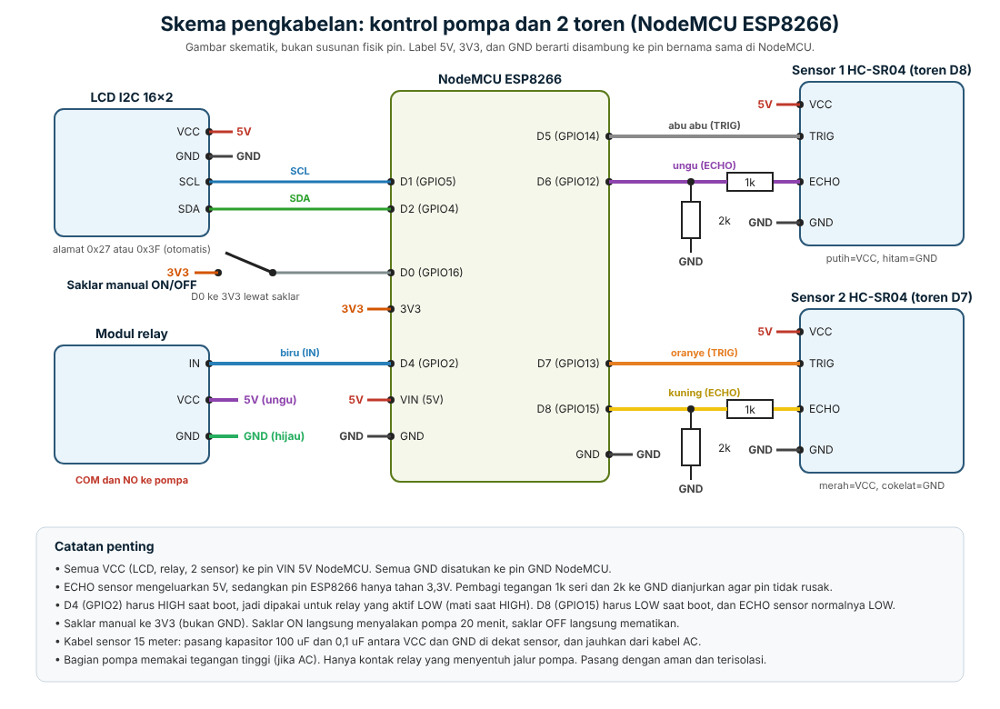

# Perangkat keras

Skema dalam format SVG ada di `skema-pengkabelan.svg`. Tabel pin ada di `PIN_MAPPING.md`.

## Komponen

- NodeMCU ESP8266
- 2 sensor ultrasonik HC-SR04 (toren D7 dan toren D8)
- Modul relay untuk pompa
- LCD I2C 16x2
- Saklar ON/OFF manual
- Resistor 1k dan 2k untuk pembagi tegangan ECHO (2 set)
- Kapasitor 100 uF dan 0,1 uF di dekat tiap sensor bila kabel panjang

## Firmware

Berkas `kontrol_pompa/kontrol_pompa.ino`. Sebelum upload, isi `FOLDER`, `WIFI_LIST`, dan `OTA_PASSWORD`. Pustaka yang dibutuhkan: `ArduinoJson` dan `LiquidCrystal I2C`.

## Simulasi Wokwi

Folder `wokwi/` adalah versi ESP32 untuk simulasi, karena Wokwi tidak mendukung ESP8266. Pin simulasi berbeda dari alat asli.
